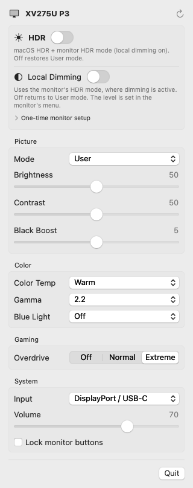

# DDC Widget for Acer

A macOS menu-bar app that controls Acer monitors over DDC/CI: picture mode, brightness, contrast, Black Boost, color temperature, gamma, blue light, overdrive, input, volume and button lock. It also has an **HDR** toggle that switches macOS HDR and the monitor's HDR mode (with local dimming) together.

Acer's own Display Widget only runs on Windows. This app fills that gap on the Mac.

> **Unofficial.** This project isn't affiliated with, endorsed by, or supported by Acer Inc. "Acer", "Nitro" and "Predator" are trademarks of their owners and are used here only to describe compatible hardware. No Acer software, code or binaries are included.



## Install

```sh
brew install JustBoryata/tap/ddc-widget-acer
ln -sf "$(brew --prefix ddc-widget-acer)/DDC Widget.app" /Applications/
open "/Applications/DDC Widget.app"
```

Homebrew builds the app from source on your Mac, so no developer signature is needed and macOS won't block it. It also installs `acer-ddc`, a command-line tool (`acer-ddc caps`, `acer-ddc get 0x10`, …).

**Requirements:** an Apple Silicon Mac, macOS 13 or later, and an Acer monitor with **DDC/CI** turned on in its menu.

## Updating

From 0.2.0, the app checks GitHub for a new release once a day. When one is out, the menu-bar icon gets a download arrow and the menu shows **Update**, which runs `brew upgrade` and restarts the app. You can also check by hand with **Check for Updates** at the bottom of the menu.

On 0.1.0, or from the terminal:

```sh
brew upgrade JustBoryata/tap/ddc-widget-acer
```

## One-time monitor setup (for the HDR / Local Dimming toggles)

Local dimming can't be set over DDC on the XV275U P3. The app switches it with picture modes instead (HDR mode turns it on, User mode turns it off). For that to work, set the monitor up once with its own buttons:

1. Set the picture mode (profile) to **User**.
2. Go to **Gaming** settings and set **Local Dimming** to **Off**.
3. **Save** the profile to **Gaming 3 (Sports)**.

## How it works

- `app/Sources/DDCKit`: DDC/CI over Apple Silicon's `IOAVService` I2C bridge. It handles the monitor's timing quirks (requests sent twice, a settle delay after writes, read-back verification) and Acer's indexed registers.
- `app/Sources/DDCWidget`: the SwiftUI menu-bar app. It reads the monitor only when the menu opens and never polls in the background, so it coexists with BetterDisplay or MonitorControl.
- macOS HDR is switched through the private MonitorPanel framework (the same setting System Settings uses). That's why this app can't go on the Mac App Store.
- `analysis/vcp-map.md`: the DDC/CI codes Acer monitors use and what each value means, verified on an XV275U P3.

Only the XV275U P3 has been tested. Other Acer monitors should show whichever controls their capabilities list. Reports are welcome.

## Build from source

```sh
cd app
swift build                    # library, CLI and app
./scripts/make-app.sh          # app/build/DDC Widget.app
./scripts/make-dmg.sh          # app/build/DDCWidget-<version>.dmg (ad-hoc signed)
```

Debug helpers: `DDCWidget --snapshot <dir>` renders the panel to PNG files, and `DDCWidget --hdr on|off` / `--dimming on|off` run the toggles without the UI. HDR and mode changes are logged to `~/Library/Logs/DDCWidget.log`.

## License

MIT. See [LICENSE](LICENSE).
